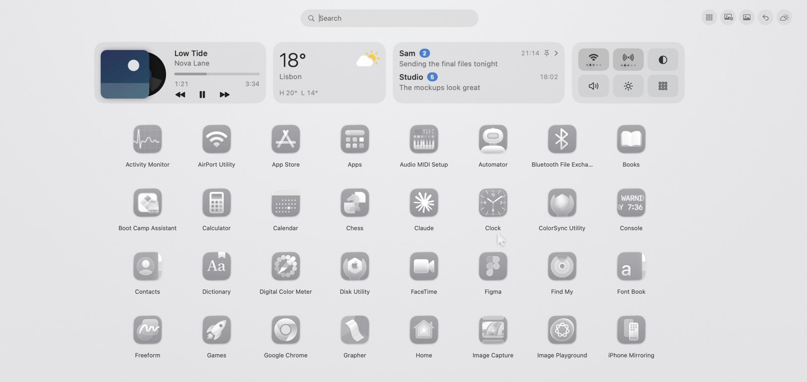
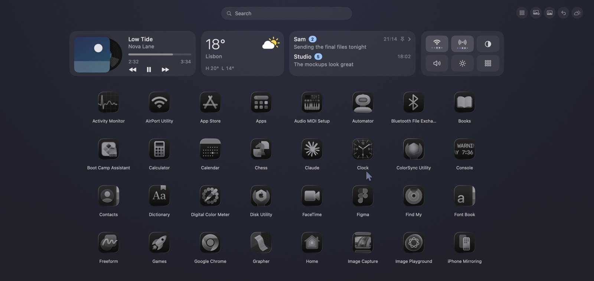

# The Launchpad prompt

macOS Tahoe took away Launchpad, so I built my own with Claude: all my apps in one grid that sorts itself, with the weather, my widgets, search and my notifications. In White Matte and Dark Matte.





1. The reference images are in this folder.
2. Copy the prompt below and paste it into Claude Code, on a Mac, with the two images attached.
3. Build it step by step: Claude shows you a plan first and waits for your OK.

**Prompt, for Claude Code**

````text
Build me a native macOS app (Swift + AppKit/SwiftUI, macOS 14 or later, Apple Silicon) that brings back Launchpad, which macOS Tahoe removed: a full-screen grid of all my apps that sorts itself, with a few widgets and my notifications. It lives in the menu bar, has no Dock icon, and starts at login only if I turn it on.

I attached two screenshots of the Launchpad I want (White Matte and Dark Matte): match their layout, sizes, spacing, rounded corners and colors as closely as you can, and use them to check each step.

Work in small steps. Before writing code, show me a short plan and the list of permissions the app will ask for, and wait for my OK. After every step, build it and tell me how to try it.

1. Opening and closing
- Opens with a global shortcut (Command+4, changeable in the settings) and, if I turn it on, with a hot corner (top-left).
- A full-screen panel above everything, on the screen where the mouse is, with a soft fade and a slight zoom in.
- Closes with Esc, with the same shortcut, with a click on an empty area, or when I launch an app.

2. The grid
- All apps from /Applications, /System/Applications, /System/Applications/Utilities and ~/Applications, alphabetical, no duplicates, no helper apps.
- 8 columns, 4 rows per page, big icons with the name under them (one line, cut with an ellipsis). Pages with left and right arrows or a two-finger swipe, and dots at the bottom.
- Click or Enter opens the app.
- A "By category" button (top right) that turns the grid into folders, like the App Library on iPhone: Productivity, Creative, Developer, Music and video, Social, Utilities, Games, Other. Use LSApplicationCategoryType from each app's Info.plist; apps without it go to Other. A folder shows its first four icons and the count; a click opens it with a back arrow.

3. Search
- A search field at the top, already focused when the grid opens. Typing filters the apps by name (also by the first letters of each word), Enter opens the first result, Esc clears and then closes.

4. Widgets on top (a single row, each can be shown or hidden in the settings)
- Now playing (Spotify and Apple Music via AppleScript): cover, title, artist, progress, play/pause/next. Ask for Automation once per player and never launch a player that is closed.
- Weather from Open-Meteo (free, no key) for a city I type in the settings: temperature, icon, high and low.
- Quick toggles: Wi-Fi, Bluetooth, dark mode, volume, brightness.
- The row must always fit the screen: scale it down if there are many widgets, never cut it at the sides.

5. Notifications, on the right
- A column with the latest notifications, read from the macOS banners with the Accessibility permission. Keep them only in memory, never on disk.
- Each one has an X to remove it. Notifications become "seen" when I close the grid after they were there; a "Clear seen" button removes all the seen ones at once. New ones have a small dot.

6. Two themes, flat and matte, switchable from the menu
- Dark Matte: background #16181F, tiles #21242D, text #E3E7EF, secondary text #A4ABBA, accent #8FC7FF.
- White Matte: background #F7F8FA, tiles #FBFBFC, text #1E2129, secondary text #545A69, accent #3B82D0.
- The wallpaper behind the grid is blurred and darkened (or lightened in White Matte). No glass effects, no gradients on the tiles.
- Icons follow the theme: switching theme also switches the macOS icon style (Settings > Appearance > Icon and widget style: tinted dark with Dark Matte, tinted light with White Matte), and the grid shows the new icons right away.

Things that will trip you up (handle them from the start)
- The panel must take the keyboard for search without making the app active or stealing focus from the app I was using: NSPanel with .nonactivatingPanel and canBecomeKey true, level above the Dock, collectionBehavior [.canJoinAllSpaces, .fullScreenAuxiliary].
- macOS reads the icon style once per process: after a theme switch, NSWorkspace.icon(forFile:) keeps returning the old icons. Render fresh icons in a short-lived helper process (the app launched again with an argument), cache them, and replace them in the grid.
- Load icons lazily and cache them at the size you draw them, or opening the grid stutters with hundreds of apps.
- Scanning folders: follow symlinks, skip .app bundles inside other .app bundles, and refresh the list when apps are installed or removed (watch the folders).
- Global shortcuts need the Accessibility permission (or a Carbon hot key): explain it in one line before asking.
- The notification banners belong to com.apple.notificationcenterui: observe it with AXObserver, wait a moment for the banner to be drawn, then read its texts. If the permission is missing, show the column empty with a short note, never crash.
- Sign the app (even with an ad-hoc signature) and keep the same bundle id between builds, or macOS asks for permissions again every time.

Rules
- Privacy first: nothing leaves the Mac except the weather request. No analytics, no accounts, notification texts never saved.
- Ask for each permission only when the feature that needs it is first used, and explain why in one line.
- Keep the code in a few clear files, with a README that says how to build, run and remove the app.
- If something can't be done on my macOS version, tell me and suggest the closest thing instead of faking it.
````

It won't come out identical on the first try. Mine is the result of many small fixes. You'll get a working first version in an hour or two: then compare it with the image, tell Claude what's different, one detail at a time. Stuck? Write me on Instagram, I'll try to help.
