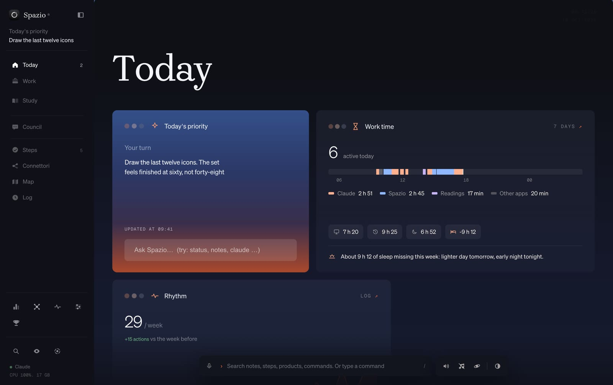
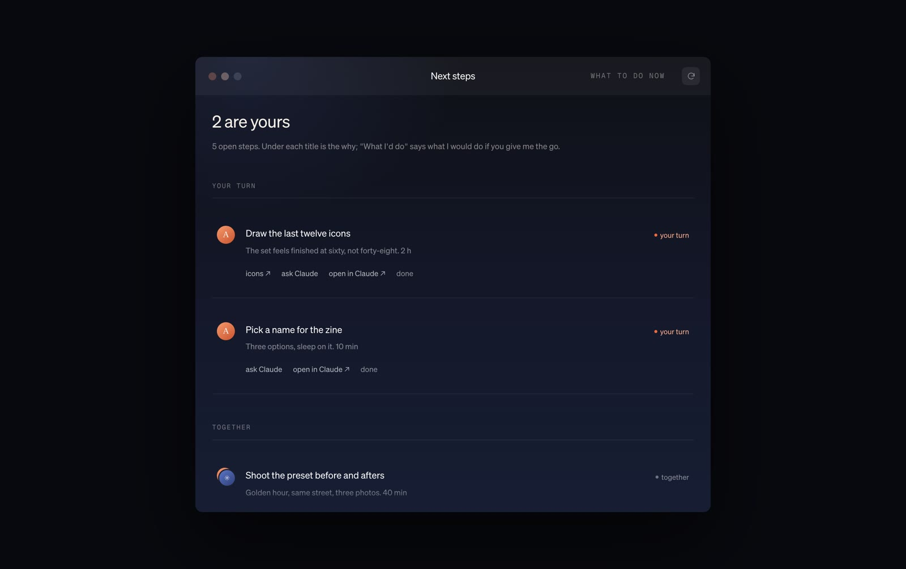

# The Spazio prompt

Spazio is the one window I open every morning: it tells me what to do first, what to post, what to study and how I'm doing. It wasn't one prompt. It started as one page and grew one instruction at a time. This is the prompt to start yours, plus the design rules I gave Claude.



## How it works, in three pieces

- **Steps.** One file with what's next, who does it (you or Claude) and what Claude should do.
- **A log.** Every session writes a line at the end, so it always knows where you are.
- **One rule.** A CLAUDE.md that tells every session to read the steps first and log at the end.

## Two things that made it look like this

- **Design rules, saved as a skill.** A short file Claude reads before any design work. Mine is below: copy it, change the colours and the fonts, save it as **SKILL.md** in a skills folder.
- **References, not adjectives.** Instead of "make it clean", show Claude two or three layouts you like and say what to take from each one.

**Design rules, as a skill**

````text
---
name: my-design-rules
description: My visual rules. Read this before any design work: pages, apps, slides, posts.
---

# My design rules

## Colour
- Background #16181F, cards #21242D, text #E3E7EF, secondary text #A4ABBA.
- One accent, #8FC7FF, used rarely: the active item, one key number.
- No gradients on cards, no glass, shadows barely visible.

## Type
- A serif for big titles (Brygada 1918), a light sans for everything else (Geist, weight 300).
- Thin type needs room around it: generous margins, few elements per card.
- Small labels in the same sans, uppercase, wide spacing. Never three typefaces at once.

## Layout
- One idea per card. If a card needs a scrollbar, it is two cards.
- Never put a box behind text to make it readable: move the text.

## How to work with me
- I give you references (screenshots), not adjectives. Tell me what you take from each.
- Change one thing at a time and show me before moving on.
````



1. The reference images are in this folder.
2. Copy the prompt below and paste it into Claude Code, with the screenshot attached.
3. Build it step by step: Claude shows you a plan first and waits for your OK. Then use it for a week before adding anything.

**Prompt, for Claude Code**

````text
Build me a small personal dashboard that runs only on my Mac, in the browser at http://localhost:8765. I'll call it Spazio. It is the one window I open every morning: it tells me what to do first, what's next, and what happened. Python standard library for the server (no frameworks, no database, no accounts), one HTML file for the page, all data in plain JSON files next to it, so Claude and I can both read and edit them.

Work in small steps. Before writing code, show me a short plan and the file list, and wait for my OK. After every step, run it and tell me how to open it.

1. The steps file (the heart)
- steps.json: a list of next steps. Each step has: id, title, why (one line), who ("me", "claude" or "together"), files to open (paths), instructions for Claude (what to do when it's Claude's turn), status (to do, doing, done), done_on, outcome.
- On the page: "Next steps", split into "Your turn", "Claude's turn" and "Together". Each step shows its title, its why in small text, and its files as links. A Done button asks for a one-line outcome and saves it.

2. Today's priority
- One card at the top with ONE thing, not a list: the first open step that is mine, or the one I pinned. A small input lets me pin a different one.

3. The log (the memory)
- log.jsonl: one line per event, with time, text and who wrote it (me or Claude).
- A tiny command line tool, spazio.py, so any session can write to it: `python3 spazio.py log "what I did"`, `python3 spazio.py step-done <id> "outcome"`, `python3 spazio.py step-new <id> "title" "why" <who> [files...]`.
- On the page: today's lines, newest first, and a "Rhythm" strip with how many things got closed each day of the last 30 days. If a week is flat, it stays flat.

4. The desk
- desk.json: folders of links (sites, tools, methods I find), each with a one-line note on why it matters. A small form to add one.

5. The rule that makes it work
- Write a CLAUDE.md in the project folder that says: at the end of every session, log what you did with spazio.py, close the steps you finished, and add a new step when something is left for me. Read steps.json before starting work.
- When I say "run the queue", open steps.json and do the open steps whose owner is "claude", one at a time, logging each.

Design
- Dark and matte: background #16181F, cards #21242D, text #E3E7EF, secondary text #A4ABBA, one accent #8FC7FF. No gradients, no glass, no shadows heavier than a whisper.
- A serif for the big titles (Brygada 1918 or another open source serif) and a light sans for everything else (Geist, weight 300). Thin type needs space around it: generous margins, few elements per card.
- A sidebar with Today, Steps, Log, Desk. Keyboard shortcuts for each.
- I attached a screenshot of my Spazio: use it for proportions, spacing and the feel of the cards, not as something to copy pixel by pixel.

Rules
- Nothing leaves the Mac. The server listens only on 127.0.0.1.
- Never lose data: write JSON files atomically, keep a dated copy before big changes.
- Keep the code in a few clear files, with a README that says how to start it, how to stop it and where the data lives.
- If something is unclear, ask me one question instead of guessing.
````

Start small. Mine grew over months, one fix at a time: a council of experts, a reading app inside it, a theme the whole Mac follows. None of that was in the first version. Use it, see what you miss, and ask Claude for that one thing.

Works on Mac and Windows: it's Python and a browser page. Nothing leaves your computer.
